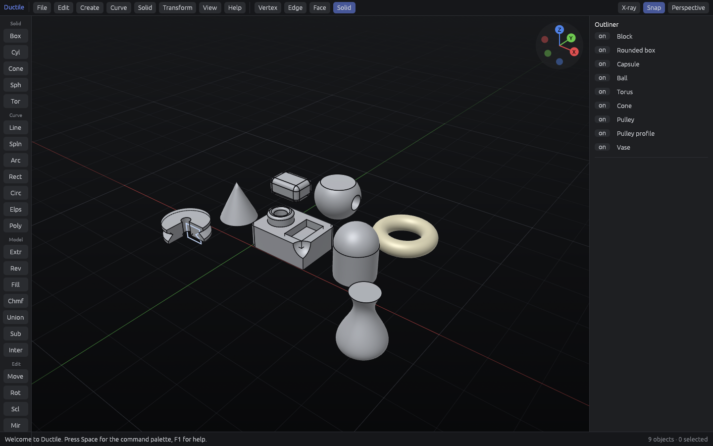

# Ductile

Ductile is a free and open-source 3D CAD modeler for Linux, written in Rust,
whose goal is to match the workflow, modeling power and feel of
[Plasticity](https://www.plasticity.xyz/): fast, keyboard-driven, NURBS-based
solid and surface modeling for artists.

It ships its own geometric kernel. The kernel's design is informed by the
public literature around industrial kernels (Parasolid, xNURBS) and by
classic references such as *The NURBS Book* (Piegl & Tiller), but contains no
code from them.



## What works today

- Primitives: box, cylinder, cone, sphere, torus (exact analytic surfaces).
- Exact booleans: union, subtract, intersect (Shift+U / Shift+D / Shift+I),
  including coplanar, tangent and pole cases.
- Curves on the construction plane: polyline (L), spline through points
  (Shift+L, open or closed C2), three-point arc (Shift+A), rectangle
  (Shift+R), circle (Shift+O), ellipse (Shift+E), regular polygon (Shift+P).
  Curves drawn separately that meet end to end form one profile. In vertex
  mode (1) spline control points show and can be selected and moved (G).
  Fillet (Shift+F) with curves selected rounds their corners (or just the
  selected vertices'); Offset curve (Alt+C) offsets them in their plane,
  rounding outside corners; Trim (Alt+T) deletes the pieces you click
  between curve crossings. Bridge (Alt+B) joins two curve ends with a new
  curve that meets them with G0 to G3 continuity and adjustable tension;
  Extend (Alt+X) lengthens open curves past their ends, naturally (lines
  and arcs stay lines and arcs, splines continue their own polynomial) or
  straight along the end tangent.
- Extrude (E): push/pull planar faces, or turn closed planar curves (with
  holes) into solids, with live preview.
- Revolve (V) closed curves by any angle about a selected edge or the
  construction plane axes; exact planes, cylinders, cones, spheres, tori,
  and NURBS surfaces of revolution for splines.
- Loft (Alt+L) through two or more closed curves, keeping corners as edges
  when the profiles match; Sweep (Alt+W) a closed curve along an open path
  with a rotation-minimizing frame (exact for straight and circular paths),
  mitred where the path turns through a sharp corner.
- Surfaces: Extrude, Revolve and Loft turn open curves into surfaces
  (exact planes, cylinders, cones, spheres and tori where the curves allow);
  Patch (Alt+P) fills closed curves, with a trimmed plane when they are
  flat (inner curves become holes) or a Coons patch through any four-sided
  (or split into four) boundary. Patch on a loop of selected edges meets
  the faces beyond them tangentially (G1), faired for even curvature: a
  tube's rim gets a smooth dome. In vertex mode (1) the control nets of
  untrimmed spline surfaces show and their points move with G, rotate and
  scale; neighbouring faces stay joined. Thicken (Alt+K) turns surfaces into
  solids of a given thickness on either side. Back faces show tinted.
- Fillets (Shift+F) and chamfers (Shift+K) on edges between planes, on
  circular plane/cylinder edges (boss and hole rims), with spherical corner
  patches where three filleted edges meet. Closed edges between any two
  surfaces (a vase lip, a loft's foot, a sphere cut flat) get rolling-ball
  NURBS fillets and chamfers with exact circular sections, and so do
  chains of tangent edges: round a box's corners, then fillet its whole
  top rim in one go; or a side edge between a spline face and a plane,
  closed off by the caps it runs into. Blends can be round, smooth (G2:
  curvature-continuous sections that leave the faces with zero curvature,
  for class-A reflections) or chamfered. Smooth blends get faired,
  curvature-continuous corner patches where three of them meet, between
  faces at any angle (a box, a hexagonal prism), and meet in clean mitres
  where a corner's third edge stays sharp.
  Straight edges between planes can also take a radius varying linearly
  along the edge (Variable radius in the Fillet panel): the round blend is
  then an exact cone, the smooth one its G2 counterpart.
- Shell (Alt+S): hollow a solid into walls of a given thickness, opening
  the selected faces, or leaving an inner void when none are selected.
  Offset solid (Alt+O) grows or shrinks a whole solid, Offset faces
  (Alt+F, or E on a curved face) pushes and pulls any faces. Faces move along
  their normals with exact offset surfaces for analytic faces, sharp edges
  stay sharp, and tangent faces (fillets) move together.
- STEP (AP214) export of exact solids and surfaces, checked against
  OpenCascade; several objects are written as an assembly with one named part each. STL and
  OBJ export. Headless: `ductile --demo --export-step out.step`.
- STEP import (File > Import STEP, or `ductile part.step`): planes,
  cylinders, cones, spheres, tori, B-spline and rational surfaces, surfaces
  of extrusion and revolution, in any length unit. Parts written by
  OpenCascade import with the volumes OpenCascade reports for them
  (`crates/ductile-io/tests/occ_import.rs`). Assemblies are flattened:
  every placed instance of a part becomes its own object, named after the
  part.
- Zebra stripes (Alt+R, or the Zebra button) to judge surface continuity:
  stripes stay unbroken across tangent (G1) joins and keep their direction
  across curvature-continuous (G2) ones. Headless: `--zebra`.
- Move / rotate / scale / mirror, linear and radial arrays (Alt+A,
  Alt+Shift+A), undo/redo.

In progress: more of Plasticity's curve and surface tools.

## Layout

| Crate | What it is |
| --- | --- |
| `ductile-geom` | Geometry: frames, NURBS curves/surfaces, analytic curves and surfaces, projection |
| `ductile-brep` | Topology and modeling: B-rep bodies, primitives, tessellation, extrude/revolve/boolean/fillet |
| `ductile-io` | File formats: native `.ductile`, STEP, OBJ, STL |
| `ductile-app` | The application: wgpu viewport + egui interface |

## Building

```sh
cargo run --release -p ductile-app
```

Requires a Vulkan or OpenGL capable GPU driver (Mesa works).

## License

GPL-3.0-only. See [LICENSE](LICENSE).
